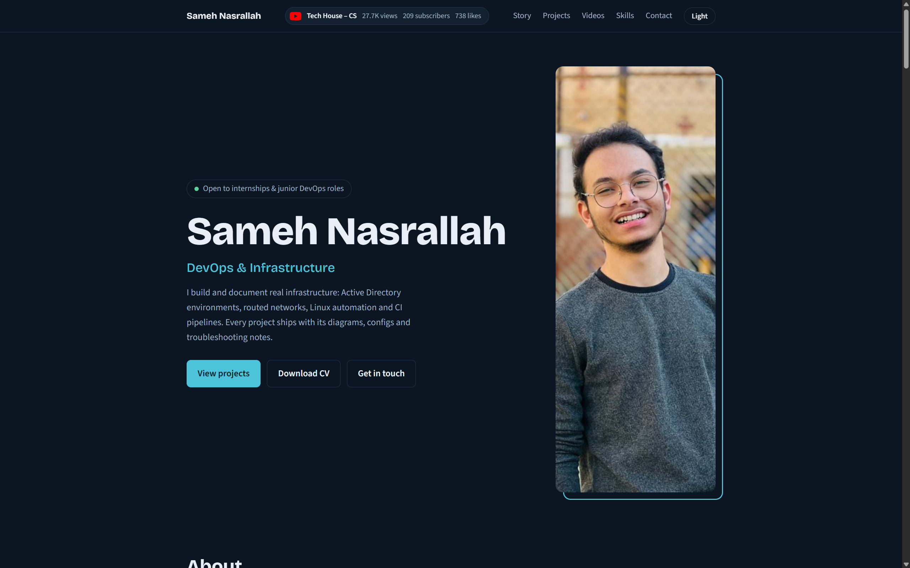

# Sameh Nasrallah | Portfolio



Personal portfolio of **Sameh Nasrallah**, a Computer Science & AI student focused on **DevOps and infrastructure**. It presents documented projects in Active Directory, Cisco networking and Linux automation, plus an Arabic YouTube channel teaching CS from the beginning.

**Live site:** https://engsamehnasrallah-web.github.io

## Highlights

- **Featured projects** with honest status labels (completed, in progress, stable release), followed by smaller tools and general programming work.
- **Scroll-driven story**: a timeline that fills as you scroll, from childhood in 2006 to the current goal.
- **YouTube section** with thumbnail cards for every video and Short, grouped into a learning path instead of a flat list.
- **Live YouTube badge** in the header showing views, subscribers and likes through the YouTube Data API v3.
- **Dark and light themes**, remembered between visits and following the system preference on first load.
- **Responsive and accessible**: works down to phone widths, visible keyboard focus, and reduced-motion support.

## Tech stack

Plain **HTML, CSS and JavaScript** in a single `index.html`. No framework, no build step, no dependencies. Fonts (Bricolage Grotesque, Source Sans 3) load from Google Fonts with system fallbacks.

## Project structure

```
.
├── index.html                  # the whole site: markup, styles and scripts
├── assets/
│   ├── profile.jpg             # portrait used in the hero
│   └── Sameh_Nasrallah_CV.pdf  # downloadable CV
└── README.md
```

File names are case-sensitive on GitHub Pages, so keep them exactly as shown.

## Run locally

```bash
git clone https://github.com/engsamehnasrallah-web/engsamehnasrallah-web.github.io.git
cd engsamehnasrallah-web.github.io
python -m http.server 8000
```

Open http://localhost:8000. Use a local server rather than opening the file directly, because the YouTube badge is restricted by HTTP referrer and will not load from `file://`.

## Deploy

The site is hosted on **GitHub Pages**:

1. Keep the repository named `<username>.github.io` and public.
2. Go to **Settings → Pages**, choose branch `main` and folder `/ (root)`.
3. Every push to `main` republishes the site.

## YouTube badge configuration

The badge reads channel statistics at page load. Near the end of `index.html`:

```js
var KEY = "...", CH = "UC5yMlk68z_l9DSeRO8ULQ2A", FALLBACK = null;
```

- `KEY` is a YouTube Data API v3 key. Because it is visible in client code, it **must** be restricted in Google Cloud: allow only the HTTP referrer `https://engsamehnasrallah-web.github.io/*` and only the YouTube Data API v3.
- `CH` is the channel ID.
- `FALLBACK` can hold fixed numbers, for example `{views: 12400, subs: 310, likes: 980}`, shown while the live request loads or if it fails.

Likes are summed across every video and Short in the channel's uploads playlist. Subscriber counts are rounded by YouTube, and the figure is omitted if the channel hides it.

## Updating content

- **Projects:** edit the cards in the `#projects`, `#more` and `#other` sections.
- **Story:** edit the `.st` blocks inside `#storyline`.
- **Videos:** each card is a `<li>` with the video link and thumbnail (`https://i.ytimg.com/vi/<id>/hqdefault.jpg`).
- **Colors:** all theme colors are CSS variables at the top of the stylesheet, with separate values for dark and light.

## Design notes

- Cool blue-teal accent on a deep navy base (dark) or a pale blue-white base (light), chosen to feel technical without a terminal cliché.
- Featured projects are rows rather than identical cards, so the strongest work reads first.
- Motion is limited to the scroll story and simple hover states, and is disabled for users who prefer reduced motion.

## Contact

- Email: engsamehnasrallah@gmail.com
- GitHub: https://github.com/engsamehnasrallah-web
- LinkedIn: https://linkedin.com/in/sameh-nasrallah
- YouTube: https://youtube.com/@samehnasralla0

## License

© Sameh Nasrallah. All rights reserved. Please do not reuse the personal content, photo or CV without permission.
